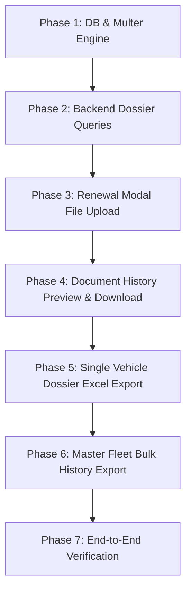

# Vehicle System Upgrade Planning
## Document Upload & Download System + End-to-End Vehicle Lifecycle Dossier Report

---

## 📌 Executive Overview
This document outlines the architectural and implementation plan for two major upgrades to the HisabKitab Vehicle Module:
1. **Vehicle Document Upload & Download Engine**: End-to-end management for attaching, previewing, and downloading physical/scanned copies (PDF, JPG, PNG) of vehicle registration certificates (RC), insurance policies, pollution under control (PUC) certificates, and other transport papers.
2. **Vehicle Lifecycle History Dossier Report ("हर गाड़ी की शुरू से अंत तक की पूरी रिपोर्ट")**: A complete start-to-present historical audit report tracking every renewal, insurance company, policy number, expense, on-time vs delayed renewals, and lifetime cumulative maintenance expenditure for individual vehicles as well as the entire fleet.

---

## 🎨 Strict Project Rules & Design Standards

| Rule | Requirement | Implementation Detail |
|---|---|---|
| **Rule 1** | Dynamic Theme Native Inheritance | No hardcoded `bg-white` or `bg-dark`. Modals, cards, dropzones, and tables dynamically adapt to user's selected light/dark theme. |
| **Rule 2** | Concise Code Preference | Modals will strictly use `<div class="modal-dialog" style="width: 98%;">`. Zero redundant utility classes. |
| **Rule 3** | Prebuilt Action Icons | Standard classes from `styles.scss`: `i-outline-primary`, `i-outline-success`, `i-outline-danger`, etc. |
| **Rule 4** | Mandatory API Error Handling | Zero silent failures. Every HTTP call, file stream, or export promise includes `toastr.error(...)` notifications. |
| **Rule 6** | Standard Excel Export Rule | Custom multi-block lifecycle report generated using structured `ExcelJS.Workbook()` with styled summary cards and auto-fitted columns. |
| **Rule 10** | Vehicle Standard Color Codes | **RC**: Indigo / Blue (`#727cf5` / `#E0E4FC` / `#3A47CD`)<br>**Insurance**: Emerald Green (`#0acf97` / `#D2F4EA` / `#087B59`)<br>**PUC**: Amber Orange (`#ffbc00` / `#FFF1D2` / `#B36B00`) |

---

## 🗄️ Architecture & Technical Specifications

### 1. Database Schema Extensions (`db.model.js`)

Extend the existing `vehicle_document` table to link physical uploaded documents and policy tracking:

```sql
-- Migration for vehicle_document attachment support
ALTER TABLE vehicle_document ADD COLUMN file_name varchar(255);
ALTER TABLE vehicle_document ADD COLUMN file_path varchar(500);
ALTER TABLE vehicle_document ADD COLUMN file_size integer;
ALTER TABLE vehicle_document ADD COLUMN mime_type varchar(50);
ALTER TABLE vehicle_document ADD COLUMN policy_no varchar(100);
```

#### Schema Fields:
- `_id`: Primary auto-increment ID.
- `vehicle_id`: Foreign key reference to `vehicle(_id)`.
- `gadi_num`: Vehicle registration number (e.g. RJ-14-EA-1234).
- `doc_type`: `'rc'` | `'insurance'` | `'puc'`.
- `doc_date`: Issue / start date of the document.
- `exp_date`: Expiry date of the document.
- `insurance_type`: Comprehensive, Third-party, Zero-dep, etc. (applicable for insurance).
- `amount`: Renewal fee / premium paid (₹).
- `file_name`: Stored physical filename (e.g. `RJ14EA1234_insurance_1729445200.pdf`).
- `file_path`: Relative URL path (`/api/public/vehicle/...`).
- `file_size`: Size in bytes.
- `mime_type`: `application/pdf`, `image/jpeg`, `image/png`.
- `policy_no`: Policy or certificate number.
- `created_at`: Audit timestamp.

---

### 2. Backend Upload & Storage Engine (`upload.routes.js`)

#### Storage Location:
Files will be stored locally in:
`/Data/Documents/vehicle/`

#### Multer Storage Configuration:
Extend `upload.routes.js` `imageMulterConfig`:
```javascript
case "vehicle": 
   imagePath = path.resolve(__dirname + "/../../../../Data/Documents/vehicle");
   break;
```

#### Upload Rules:
- Allowed Formats: PDF (`application/pdf`), Images (`image/jpeg`, `image/png`, `image/webp`).
- Max File Size: 10 MB per file.
- Automatic Folder Creation: `fs.mkdirSync(imagePath, { recursive: true })`.
- File Naming Convention: `${clean_gadi_num}_${doc_type}_${Date.now()}${extension}`.

#### Static File Serving:
Configured via existing Express static route in `backend/app.js`:
`app.use('/api/public', express.static(path.join(__dirname + '/../../Data/Documents')));`
Files accessible at: `/api/public/vehicle/<filename>`

---

### 3. API Endpoints

| Method | Endpoint | Description |
|---|---|---|
| `POST` | `/api/upload/image` | Uploads file to `/Data/Documents/vehicle/` (Type: `'vehicle'`). |
| `DELETE` | `/api/upload/image` | Deletes file from disk safely. |
| `GET` | `/api/vehicle_document/by_vehicle/:vehicle_id` | Fetches chronological renewal records with file metadata for a specific vehicle. |
| `POST` | `/api/vehicle_document/attach_file` | Links an uploaded file to an existing `vehicle_document` entry. |
| `GET` | `/api/vehicle/lifecycle_dossier/:vehicle_id` | Aggregates full vehicle profile, lifetime expenditure metrics, and chronological document timeline. |
| `GET` | `/api/vehicle/master_fleet_lifecycle` | Aggregates all vehicles' entire lifetime history for bulk ledger export. |

---

### 4. Frontend UI/UX Upgrades

#### A. Quick Renewal Modal (`vehicle.component.html`)
Inside each of the 3 renewal cards (**RC**, **Insurance**, **PUC**):
- Add file upload input with drag-and-drop support:
  - Custom styled dropzone matching card theme colors (Rule 10).
  - Selected file badge showing filename and file size with clear button.
  - Policy/Certificate No input field.
- On renewal submit:
  - Form data and file uploaded simultaneously.
  - Success toastr notification confirming renewal and document archive.

#### B. Renewal & Document History Modal (`docHistoryModal`)
- **Lifetime Financial Summary Header**:
  - 4 Executive KPI Badges:
    - 🔵 Total RC / Fitness Expenses: ₹ XX,XXX
    - 🟢 Total Insurance Premiums: ₹ XX,XXX
    - 🟠 Total PUC Expenses: ₹ X,XXX
    - 🟣 Grand Total Lifetime Maintenance: ₹ XXX,XXX
- **Chronological History Table**:
  - Shows all past renewals from day 1 to present.
  - Attachment Column:
    - **View / Preview**: Opens PDF preview modal or image popup directly inside the app.
    - **Download**: 1-click download with proper filename (`gadi_num + doc_type + exp_year`).
    - **Upload Missing**: If a past record has no file, an upload icon allows attaching the archive retroactively.
- **Export Vehicle Dossier Button**: Direct button to download the vehicle's full lifecycle report in Excel.

#### C. Vehicle Entry Form (`vehicle-entry.component.html`)
- In RC, Insurance, and PUC sections: Add initial document attachment inputs so papers can be scanned and saved during vehicle onboarding.

---

### 5. Full Lifecycle Dossier Report & Excel Export Engine

#### Structure of the Excel Dossier (Individual Vehicle):
A single multi-block, presentation-grade Excel workbook generated using `ExcelJS`:

1. **Sheet Title & Timestamp**:
   - Organization Title, Report Generation Timestamp, Active Status.
2. **Vehicle Profile Block (Card Style)**:
   - Registration No | Vehicle Make / Name | Vehicle Type | Fuel Type
   - MM / Department | Owner Name | Nominee | Purchase / Registration Date
   - Chassis No | Engine No | Seating Capacity
3. **Financial Summary Box (4-Box KPI Grid)**:
   - Total Insurance Spent (₹) | Total PUC Spent (₹) | Total RC/RTO Spent (₹) | Grand Total Lifetime Cost (₹)
4. **Chronological Renewal Timeline (Start to Present)**:
   - `Sr No.`
   - `Document Type` (RC, Insurance, PUC with exact Rule 10 fill & font colors)
   - `Policy / Doc No.`
   - `Provider / Insurance Company`
   - `Start Date` & `Expiry Date`
   - `Tenure / Validity`
   - `Renewal Amount (₹)`
   - `Compliance Status` (Renewed On-Time, Delayed by X Days, Current Active)
   - `Archived Document Attached` (Yes / No)

#### Master Fleet Lifecycle Ledger (All Vehicles):
- Comprehensive export for auditing and accounting:
  - Consolidates every vehicle's historical journey into a master sheet.
  - Filterable by MM, Vehicle Type, Date Range, and Status.
  - Includes total expenditure subtotals per vehicle.

---

## 🗓️ Phased Implementation Roadmap



### Detailed Execution Steps:
1. **Step 1 (Backend)**: Add `'vehicle'` case to `backend/api/routes/upload.routes.js` and verify directory creation.
2. **Step 2 (Database)**: Update `db.model.js` with migration for `vehicle_document` attachment columns (`file_name`, `file_path`, `file_size`, `mime_type`, `policy_no`).
3. **Step 3 (Backend Services)**: Implement `getVehicleLifecycleDossier` and `getMasterFleetLifecycle` in `vehicle.service.js` with lifetime cost aggregates.
4. **Step 4 (Frontend UI)**:
   - Enhance 3-card Renewal modal with file attachment dropzone.
   - Upgrade Document History modal with file preview, download actions, and financial summary cards.
5. **Step 5 (Excel Export)**:
   - Implement `exportVehicleLifecycleDossier(...)` in `excel-export.service.ts` applying Rule 6 and Rule 10.
   - Implement Master Fleet Lifecycle export button on main vehicle toolbar.
6. **Step 6 (Testing & QA)**:
   - Test PDF and Image upload, preview modal, download integrity.
   - Verify Excel export formatting, formulas, and theme-neutral colors.
   - Confirm strict Rule 1, 2, 3, 4, 6, 10 adherence.
